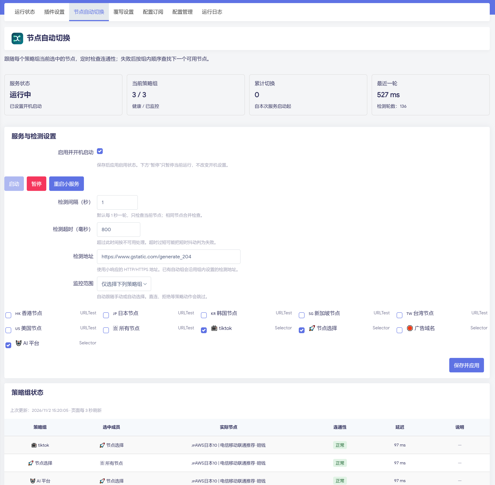

# OpenClash FF


**FF = Fast Failover，OpenClash 当前节点快速故障切换插件。**

用“1 元机场”省下了钱，却经常在晚高峰花时间切节点。

节点卡住了，网页还在转圈，下一轮自动测速可能还要等几分钟。OpenClash FF 就是为这段等待写的：**默认每秒检查各策略组当前选中的节点，失败后按顺序寻找下一个可用节点。**

搭配 OpenClash 使用，沿用现有订阅、DNS 和分流规则。手动选节点、自动选节点都能跟随；多个组用同一节点，只检查一次。



## 支持情况

| 环境 | 状态 |
| --- | --- |
| OpenWrt / ImmortalWrt ARM64 + OpenClash | 已实机验证，包含 LuCI 页面 |
| Linux amd64、386、ARMv6/v7、MIPS/MIPSLE | 提供静态交叉构建，待对应设备实测 |
| 其他 Linux 系统 | 可运行守护程序；需要自行配置 Mihomo 控制接口和进程管理 |
| Windows / macOS / iOS | 当前未适配 |

LuCI 页面需要现有 OpenClash 环境提供 luci-compat、luci.jsonc、nixio 和 curl。使用 nftables 或 iptables 不影响本服务：它只访问 Mihomo 控制接口。

## 部署

在路由器 SSH 执行（默认优先中国大陆加速，失败回退其他线路）：

```sh
(curl -fL --connect-timeout 10 --max-time 60 https://gh-proxy.com/https://raw.githubusercontent.com/andyfanybo/openclash-ff/main/install.sh -o /tmp/install-openclash-ff.sh || curl -fL --connect-timeout 10 --max-time 60 https://raw.githubusercontent.com/andyfanybo/openclash-ff/main/install.sh -o /tmp/install-openclash-ff.sh) && sh /tmp/install-openclash-ff.sh
```

脚本自动识别架构、下载最新 Release、核对 SHA-256 并安装 LuCI 页面。首次安装尝试读取 OpenClash 的控制端口与认证设置并启用服务；升级保留配置及原运行状态。

仅使用 GitHub 直连：`FF_MIRROR=direct sh /tmp/install-openclash-ff.sh`。自定义加速前缀：`FF_MIRROR=https://你的加速域名 sh /tmp/install-openclash-ff.sh`。加速由第三方提供，可用性会变化；校验用于检查下载完整性。

安装后打开 **服务 → OpenClash → 节点自动切换**。依赖现有 OpenClash、curl、tar、sha256sum 和 od；自动读取认证配置还需 Ruby。

### 手动编译安装

先在电脑上下载项目源码，安装 Go 1.23 或以上版本。在 Linux、macOS 或 Windows 的 WSL/Git Bash 中执行：

```sh
sh scripts/build.sh
```

也可以从 GitHub 的 **Actions → Build → Artifacts** 下载构建产物，解压到源码的 `dist` 目录，跳过本地编译。

根据路由器的 `uname -m` 选择文件：

| uname -m | 二进制文件 |
| --- | --- |
| aarch64 | node-guard-linux-arm64 |
| x86_64 | node-guard-linux-amd64 |
| i386 / i686 | node-guard-linux-386 |
| armv7l | node-guard-linux-armv7 |
| armv6l | node-guard-linux-armv6 |
| mips | 确认大小端后选择 mips 或 mipsle；两者均采用 softfloat |

MIPS 的 `uname -m` 不一定能区分大小端，请同时查看 `ubus call system board` 的 target 和固件架构。选错架构会出现无法执行文件的错误。

把源码目录传到路由器 `/tmp/node-guard-src`，将所选二进制放到该目录的 `dist/node-guard`。例如 ARM64，在电脑执行（替换路由器地址）：

```sh
scp -O -r . root@ROUTER_IP:/tmp/node-guard-src
```

进入路由器 SSH：

```sh
cd /tmp/node-guard-src
cp dist/node-guard-linux-arm64 dist/node-guard
sh packaging/install.sh
```

安装脚本会保留已有配置，首次安装使用默认配置。默认控制接口为 `http://127.0.0.1:9090`。如果端口不同，编辑 `/etc/node-guard/config.json`。

如果 Mihomo 控制接口设置了 secret，把它保存到 `/etc/node-guard/secret`，权限设为 600，并将配置中的 `secret_file` 改为该路径。这里填的是控制接口密码，不是 SSH 密码。

安装后在 LuCI 打开 **服务 → OpenClash → 节点自动切换**，检查参数，点击“保存并应用”启用。安装脚本本身不会自动启动服务。未看到标签时，刷新页面或重新登录 LuCI。

## 参数

| 参数 | 默认值 | 含义 |
| --- | --- | --- |
| 检测间隔 | 1 秒 | 每轮检查当前选中的实际节点 |
| 检测超时 | 800ms | 超过此时间按不可用处理，弱网可适当调大 |
| 监控范围 | 全部支持的策略组 | 也可以在页面只勾选需要的组 |

下一候选会加入下一轮检查，通过才切换；也失败就继续往后找。支持 Selector、URLTest 和 Fallback，嵌套组优先在内层处理。直连、拒绝等动作会跳过。

每秒检测不代表保证一秒恢复，多个坏候选会延长等待。检查的是连通性，不是下载速度，也不能判断 AI 账户或地区限制。已有长连接仍可能需要应用自行重连。

URLTest/Fallback 在故障后被服务改选，可能显示为固定选择，可在原面板解除固定。OpenClash 原有的周期检测可以继续保留。

## 管理

普通 Linux 环境可以直接运行对应架构的二进制：`./node-guard-linux-amd64 -config config.example.json`。控制接口配置方式相同，LuCI 页面和 procd 启动脚本仅用于 OpenWrt 系固件。

```sh
logread -e node-guard
cat /tmp/node-guard/status.json
/etc/init.d/node-guard restart
/etc/init.d/node-guard stop
```

卸载服务：

```sh
/etc/init.d/node-guard stop
/etc/init.d/node-guard disable
rm /usr/bin/node-guard /etc/init.d/node-guard
```

移除 LuCI 页面时，再删除安装脚本中列出的三个页面文件，并清理 LuCI 菜单缓存。配置目录可以保留。

## 开发

```sh
CGO_ENABLED=0 go test ./...
CGO_ENABLED=0 go vet ./...
```

实现细节见 [DESIGN.md](DESIGN.md)。项目通过 Mihomo API 工作，没有内置代理内核。感谢 [Mihomo](https://github.com/MetaCubeX/mihomo) 和 [OpenClash](https://github.com/vernesong/OpenClash)。

## 项目

仓库：[andyfanybo/openclash-ff](https://github.com/andyfanybo/openclash-ff)。内部服务名仍为 `node-guard`，方便已有安装升级。
